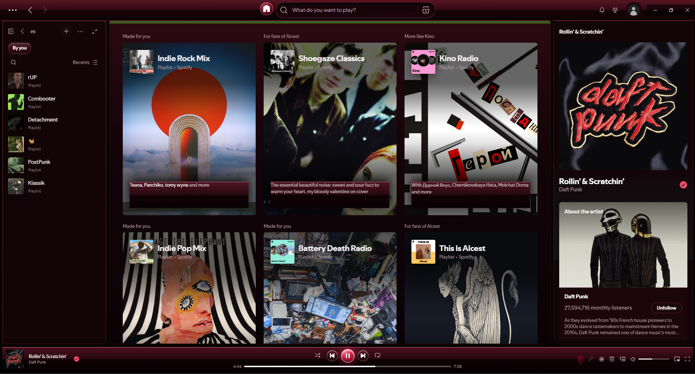
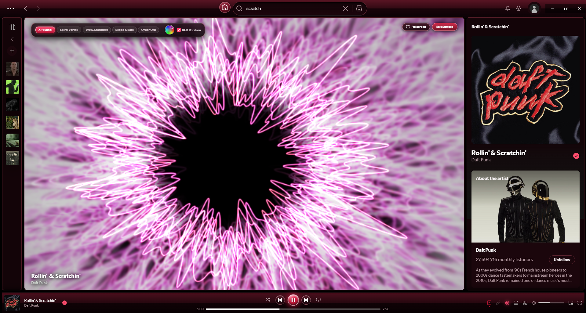
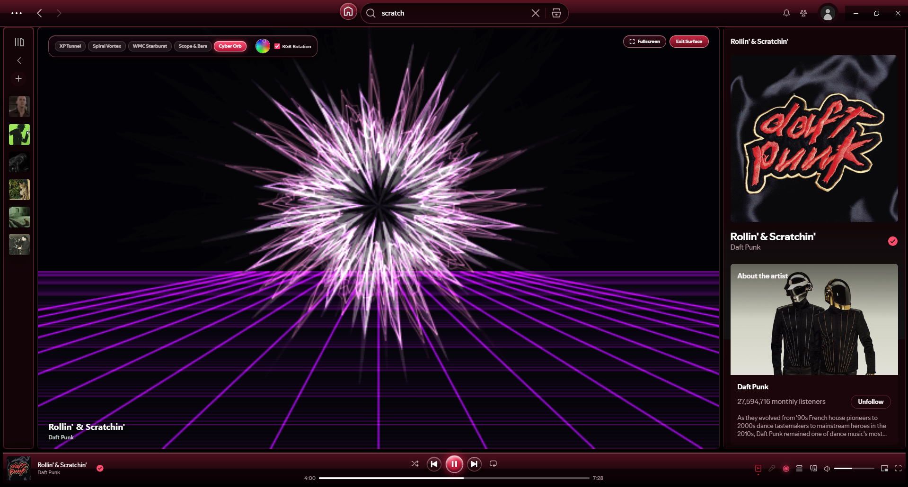
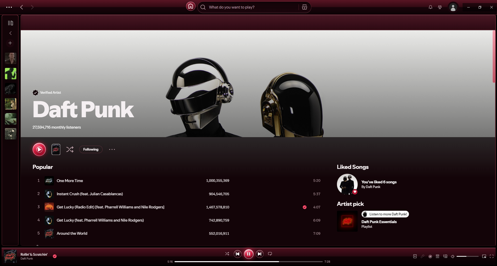

<p align="center">
  
</p>

<h1 align="center">🍷 Spotify Velvet Red Edition</h1>

<p align="center">
  <strong>A Windows Media Player 9 Series Velvet Red overhaul for Spotify Desktop (1.3.9.2055+ — official Spotify download only, not compatible with the Microsoft Store version).</strong><br>
  Includes automatic <strong>SpotX</strong> pre-installation, authentic <strong>WMP 9 Velvet Chrome &amp; Left Taskbar</strong> layout, top-mounted seekbar with oval jewel thumb, a Compact <strong>3D Crimson Play/Pause Orb</strong> cradle, and all <strong>9 Classic WMP Visualizers</strong> (`No Visualization`, `Album Art`, `Alchemy`, `Ambience`, `Bars and Waves`, `Battery`, `Particle`, `Plenoptic`, `Spikes`) powered by Spotify's native 3-band protobuf waveforms &amp; BPM telemetry.
</p>

<p align="center">
  <a href="#-installation-guide"></a>
  <a href="#-installation-guide"></a>
  <a href="LICENSE"></a>
  <a href="https://github.com/arshiatxd/velvetredspotify"></a>
</p>

<br>

<p align="center">
  
</p>

---

## ✨ Features

- **WMP 9 Series Chrome & Velvet Red Palette**:
  - Brushed crimson chrome header bar with recessed search capsule, `#wmp-left-taskbar` pill navigation (`Now Playing`, `Media Guide`, `Browse`, `Media Library`, `Lyrics` with active `▸` indicator), and obsidian right sidebar framing.
  - Recessed `#000000` main stage bezel with docked WMP stage controls, cascading visualization/preset selector menu, and live playing status ticker.
  - Deep crimson smoked glass highlights, translucent tracklist selections, and borderless navigation arrows.
  
- **WMP 9 Inverted Transport Bar & Oval Jewel Sliders (`1.3.9.2055`)**:
  - Seekbar repositioned **above** the transport cradle (`flex-direction: column-reverse`) with an always-visible metallic oval thumb on both timeline and volume sliders.
  - Compact pill cradle wrapping Shuffle, Previous, centerpiece `38px × 38px` **3D Crimson Jewel Play/Pause Orb**, Next, and Repeat with `#ffffff` glyphs and clean active indicators.
  
- **9 Classic WMP Visualizer Engines + 21 Presets**:
  - Powered by Spotify's native 3-band protobuf waveforms, kick/snare/hi-hat transient detection, pre-allocated `192×144` offscreen pixel buffers, and `480`-particle 3D projection arrays:
    1. **No Visualization**: Pure `#000000` black stage with subtle top-left Artist & Track title metadata.
    2. **Album Art**: Centered cover artwork with dynamic radial ambient glow, mirrored vertical floor reflection, and glossy eighth-note fallback.
    3. **Alchemy** (`Velvet Blossom`, `Random`, `Crimson Bloom`): Authentic Windows XP WMP 9 style — 4-quadrant mirrored soft watercolor/airbrush gradient clouds with delicate horizontal pastel sheen (`Velvet Blossom` / `Crimson Bloom`), plus drifting watercolor radial washes and sinuous gossamer spectral ribbons (`Random`) with zero dot/bead clutter.
    4. **Ambience** (`Warp`, `Water`, `Fire`): Contrast-carved marbled warp plasma around an organic black void, dual-center water caustics, and vertical flame plumes.
    5. **Bars and Waves** (`Bars`, `Scope`, `Ocean Mist`): 32-band segmented spectrum bars with falling gravity peak caps, smoothed dual oscilloscope waveforms, and glowing mist ribbons.
    6. **Battery** (`Brightsphere`, `Electriarnation`, `Whirlpool`, `Smoke & Water`): Continuous Cartesian domain-warped fluid plasma wisps (`Brightsphere` with soft floating aura blooms, `Smoke & Water` with silky wave curtains — free of center whirlpool pinches), curved electric tendrils (`Electriarnation`), and 128-step chromatic spiral vortices (`Whirlpool`).
    7. **Particle** (`Rotating Particle`, `Galaxy Fountain`, `Aurora Drift`): 3D projected undulating wave matrix ribbons (`Rotating Particle`), 180 3D parabolic comet light trails (`Galaxy Fountain`), and 4 depth-layered quadratic Northern Lights curtains (`Aurora Drift`).
    8. **Plenoptic** (`Smokey Circles`, `Prism Tunnel`, `Fractal Web`): Outward-expanding fluid feedback persistence rings (`Smokey Circles`), expanding curved 6-petal harmonic spline rings with swirling fluid trails (`Prism Tunnel`), and continuous multi-harmonic spirograph silk filaments (`Fractal Web`).
    9. **Spikes** (`Radial Flare`, `Crimson Corona`, `Crossfire`): 8-fold symmetric translucent flare rays blooming from a dark center aperture with gentle concentric rings.
  - **Interactive Color Studio**:
    - **RGB Color Wheel Picker**: Click or drag anywhere on the 2D HSV/RGB color wheel to set a custom hue and saturation.
    - **RGB Color Rotation Checkbox**: Enable continuous rhythm-driven hue rotation or lock in your exact selected color.
  - **Dual Viewing Modes + Fullscreen 5-Second Auto-Hide & Seamless Navigation**:
    1. **Lyrics Screen (with On/Off Toggle)**: Renders behind Spotify lyrics (and full-viewport in Fullscreen) with a top-bar **`Visualizer: ON / OFF`** toggle; customization controls show in the Lyrics top bar only when enabled, auto-hide along with the cursor after 5 seconds of mouse inactivity in Fullscreen, and wake immediately on mouse movement.
    2. **Dedicated Visualizer Surface Screen (`Now Playing`)**: Open via the spacious **`Now Playing`** WMP taskbar tab, the bottom-right equalizer icon, or `Alt+V` for a click-safe unobstructed stage (`pointer-events` click-through blocked) with a cascading engine/preset popup menu (`≡`), Prev/Next preset steppers (`<` / `>`), docked status ticker (`BPM · 3-Band | Total Time`), **`Sensitivity`** (`Subtle` / `Balanced` / `Overdrive`), **`Fullscreen`** (`F` / `Esc` with 5-second idle bar & cursor auto-hide), and **`Exit Surface`**. Clicking `Media Guide`, `Browse`, `Media Library`, `Lyrics`, `Back`, `Forward`, `Home`, `Search`, sidebar playlists, or now-playing links immediately exits Surface Mode cleanly.
  - **Native 3-Band Waveform & BPM Sync (`1.3.9.2055`)**: Decodes Spotify's protobuf `MetadataExtensions` (`THREEBAND_WAVEFORMS`, `AUDIO_ATTRIBUTES_V2`, `BEATS`, `LIST_TUNER_AUDIO_ANALYSIS`) alongside `PlayerAPI` and playback clock synchronization so tempo engages automatically without manual seekbar clicks.

- **SpotX-First Lightweight Single-File Installer**:
  - Compact `~241 KB` (`247,296` bytes) standalone `.exe` that runs **SpotX** first when requested/missing and injects gzip-compressed Velvet Red assets in-place into `xpui.spa`.

- **Ultra-Low RAM & Zero Background Overhead**:
  - Pre-allocated typed arrays (`Float32Array`, `Uint32Array`, LUTs) and DPR-capped 2D Canvas buffers minimize GC churn; `cancelAnimationFrame` halts rendering completely outside active visualizer views.

- **Custom Multi-Resolution Application Icon**:
  - Multi-size Windows `.ico` bound directly to Desktop, Start Menu, and Taskbar shortcuts without altering `Spotify.exe` digital signatures.

---

## 📸 Visualizer Studio & Theme Gallery

| **XP Tunnel** | **Spiral Vortex** |
| :---: | :---: |
|  |  |

| **WMC Starburst** | **Scope & Bars** |
| :---: | :---: |
|  |  |

| **Cyber Orb** | **Fullscreen Studio Mode** |
| :---: | :---: |
|  |  |

| **Lyrics Screen Integration** | **Artist View & Glass Controls** |
| :---: | :---: |
|  |  |

---

## 🚀 Installation Guide

> **Important Prerequisite — Install Official Spotify Desktop First:**
> `Spotify_VelvetRed_Setup.exe` (`~241 KB`) runs **SpotX** and patches Spotify's frontend (`%APPDATA%\Spotify\Apps\xpui.spa`) in-place. It does **not** redistribute Spotify's desktop runtime binaries.
> - Install the **official Windows Desktop version of Spotify** (`1.3.9.2055`, downloaded from [spotify.com/download/windows](https://www.spotify.com/download/windows/), not the Microsoft Store edition) before running setup.

---

### Step-by-Step Setup (Recommended)

1. **Install Official Spotify (if not already installed)**:
   - Download and install Spotify Desktop from [spotify.com/download/windows](https://www.spotify.com/download/windows/) and sign in once so `%APPDATA%\Spotify\Apps\xpui.spa` exists.
2. **Download the Velvet Red Installer**:
   - Download **[`Spotify_VelvetRed_Setup.exe`](Spotify_VelvetRed_Setup.exe)** from this repository (**Download raw file**).
3. **Run `Spotify_VelvetRed_Setup.exe`**:
   - Double-click `Spotify_VelvetRed_Setup.exe`. *(If Windows SmartScreen prompts for an unsigned executable, click **More info** → **Run anyway**).*
4. **Install SpotX + Velvet Red**:
   - Keep **Install / Update SpotX first** checked and click **`Install & Launch Spotify`**.
   - The installer automatically closes Spotify, runs SpotX safely (`podcasts_on`, `block_update_on`, `new_theme`), injects `/velvet-red.css` and `/lyrics-visualizer.js` into `xpui.spa`, installs `velvet_red.ico` on shortcuts, clears stale CEF cache, and launches Spotify.

*Silent / unattended CLI switches are supported via PowerShell or Command Prompt:*
```cmd
Spotify_VelvetRed_Setup.exe /S
Spotify_VelvetRed_Setup.exe /S /SPOTX
Spotify_VelvetRed_Setup.exe /S /RESTORE
```
*(Optional `/START` flag relaunches Spotify automatically after a silent `/S` install.)*

---

### 🎮 How to Use the Visualizer Studio

- **Dedicated Visualizer Surface Screen (`Now Playing`)**:
  - Click **`Now Playing`** on the left WMP taskbar, click the **Equalizer icon** in the bottom-right player bar (left of Lyrics), or press **`Alt+V`**.
  - Click **`≡`** in the docked WMP stage bar to open the cascading menu across all 9 WMP categories (`No Visualization`, `Album Art`, `Alchemy`, `Ambience`, `Bars and Waves`, `Battery`, `Particle`, `Plenoptic`, `Spikes`) and switch sub-presets, or cycle engines/presets directly with **`<`** / **`>`**.
  - Drag the **RGB Color Wheel** to set hue/saturation, toggle **`RGB Rotation`**, and choose **`Subtle`**, **`Balanced`**, or **`Overdrive`** sensitivity.
  - Click **`Fullscreen`** (or press **`F`**; **`Esc`** exits). Toolbars and cursor auto-hide after 5 seconds idle and wake immediately when moving the mouse.
- **Lyrics Screen Visualizer (On/Off)**:
  - Open **Lyrics** (`Lyrics` tab or `🎤` button). Opening Lyrics from Surface Mode exits Surface Mode automatically.
  - Toggle **`Visualizer: ON / OFF`** in the Lyrics top bar; customization controls and Fullscreen appear cleanly only when turned ON, with the same 5-second idle toolbar/cursor auto-hide when fullscreened.

---

### 🔄 Restoring Default Spotify / After Spotify Updates

- **To Uninstall Velvet Red (keeping SpotX)**:
  - Run `Spotify_VelvetRed_Setup.exe` and click **Restore Backup** (or pass `/S /RESTORE`). Velvet Red stylesheets, scripts, and shortcut icons are removed cleanly while SpotX remains intact.
- **If Spotify Updates**:
  - Run `Spotify_VelvetRed_Setup.exe` with **Install / Update SpotX first** checked to patch SpotX and re-apply Velvet Red cleanly.

---

## 📋 Patch Notes — v1.3.9.2055 Update

- **Full Spotify `1.3.9.2055` Compatibility**: Updated CSS selectors and Lyrics stacking context (`.R1kU6b2KxZc8FWfbYf3m`, `.f42lbbUT05gjuREF86Hw`, `.ISEJ4fISQcRgNTF5dVAA`, `.wYWhVPZoG93lR7ogMIug`, `.Ii0P5lvVrAzHgsutQTVz`, `._b8eissBsp4_ca4mU_sz`, `.KRh8uwq7KdGWbUxAjaXw`) for Spotify Desktop `1.3.9.2055`.
- **WMP 9 Series Velvet Red Layout Overhaul**: Added the widened spacious `#wmp-left-taskbar` pill rail (`96px` rail with `36px` tall buttons and `8px` spacing for `Now Playing`, `Media Guide`, `Browse`, `Media Library`, `Lyrics`), brushed chrome header bar, recessed obsidian `#main-view` bezel, docked bottom WMP stage control strip with cascading preset menu & LED status ticker, top-mounted seekbar above transport controls with oval jewel thumbs, and a compact pill cradle around the 3D Crimson Play/Pause Orb.
- **Complete 9-Engine Classic WMP Visualizer Suite**: Added all 9 Windows Media Player 9 Series visualizer categories & 21 presets (`No Visualization`, `Album Art` with floor reflection, authentic Windows XP watercolor `Alchemy` without dot/bead objects, smoothed `Ambience`, `Bars and Waves`, Cartesian domain-warped fluid `Battery` without center whirlpool seams, 3D wave/trail/curtain `Particle`, fluid feedback & spirograph `Plenoptic`, and soft-aperture `Spikes`) — eliminating central throbbing orbs, whiteout clipping, and jagged Nyquist edges while keeping smooth eye-friendly motion.
- **5-Second Fullscreen Auto-Hide & Canvas Click Guard**: Added a 5-second inactivity timer hiding overlay toolbars and cursor across both Visualizer Surface Fullscreen and full-viewport Lyrics Fullscreen (`wmp-fs-idle`, waking on mouse movement), plus Surface canvas click-through isolation so canvas clicks never reach hidden uploader inputs underneath.
- **Seamless Visualizer Surface Navigation**: Connected `Platform.getHistory()` listener and capture-phase click/focus guards so clicking WMP taskbar tabs, `Back`, `Forward`, `Home`, `Search`, `Browse`, `Lyrics`, Left Sidebar items, or now-playing links immediately exits Visualizer Surface Mode cleanly without canvas overlap.
- **SpotX-First Installer Overhaul**: Added automatic SpotX pre-installation (`/SPOTX`), non-interactive execution guards, and safe in-place `xpui.spa` patching (`247,296 bytes`).
- **Native 3-Band Waveform & Auto-Tempo Engine**: Migrated to Spotify `1.3.9.2055` protobuf `MetadataExtensions` (`THREEBAND_WAVEFORMS`, `AUDIO_ATTRIBUTES_V2`, `BEATS`, `LIST_TUNER_AUDIO_ANALYSIS`) with `PlayerAPI` + DOM clock sync so BPM and reactivity engage automatically without seekbar clicks.

---

## 🔒 Privacy & Account Security

- **Zero Credentials Touched**: Operates strictly within Spotify's local presentation layer (`xpui.spa`).
- **Local DPAPI Encryption**: Credentials and session tokens stay untouched in `%APPDATA%\Spotify\Users\`.
- **Open-Source**: Full comment-free source lives in [`src/SetupInstaller.cs`](src/SetupInstaller.cs), [`src/xpui.css`](src/xpui.css), and [`src/lyrics-visualizer.js`](src/lyrics-visualizer.js).

---

## 🛠️ Technical Details

| Component | Implementation |
| :--- | :--- |
| **Target Client** | Spotify Desktop `1.3.9.2055` (`%APPDATA%\Spotify\Apps\xpui.spa`) |
| **Theme Layer** | Aero Glass & Velvet Red CSS (`src/xpui.css` → `/velvet-red.css`) |
| **Visualizer Engine** | 9-Engine WMP 9 Series 2D Canvas Studio with Protobuf `MetadataExtensions` (`src/lyrics-visualizer.js` → `/lyrics-visualizer.js`) |
| **Icon Resource** | Multi-res `.ico` (`assets/spotify-final.ico` → `%APPDATA%\Spotify\velvet_red.ico`) |
| **Installer** | Standalone C# WinForms single-file executable (`247,296 bytes`) |

---

## 📄 License

This project is licensed under the [MIT License](LICENSE).
