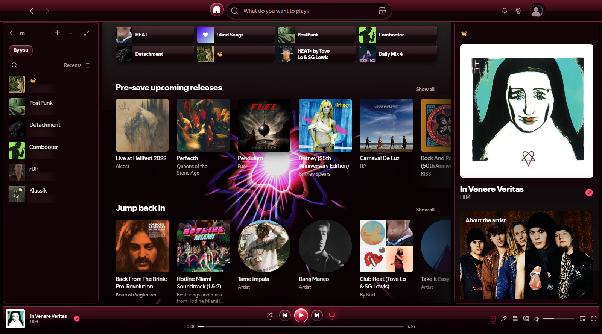
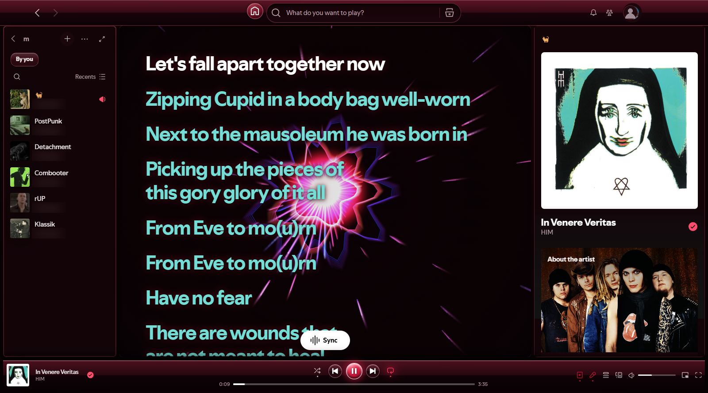

<p align="center">
  
</p>

<h1 align="center">🍷 Spotify Velvet Red Edition</h1>

<p align="center">
  <strong>An authentic Windows 7 Aero Glass & Windows Media Player 11 Velvet Red overhaul for Spotify Desktop.</strong><br>
  Featuring a stationary Windows Media Center (Vista) music-reactive lyrics visualizer with multi-edge palpitations, dynamic neon spectrum shifts, and centered 3D Glass Jewel transport controls.
</p>

<p align="center">
  <a href="#-installation"></a>
  <a href="LICENSE"></a>
  <a href="https://github.com/arshiatxd/velvetredspotify"></a>
</p>

<br>



---

## ✨ Features

- **Windows 7 Aero Glass & Velvet Red Palette**:
  - Deep crimson smoked glass frame with dual-tone Aero reflection highlights.
  - Ruby acrylic sidebar panels, glossy 3D filter capsules, and translucent tracklist selection highlights.
  - Clean, borderless top navigation arrows without distorted oval boundaries.
  
- **Symmetrically Centered WMP 11 Transport Controls**:
  - Centerpiece 3D Glass Jewel Play/Pause Orb (`40px × 40px`).
  - Circular Ruby Satellite Previous & Next buttons (`34px × 34px`).
  - Flush Shuffle and Repeat controls.
  - All transport buttons share an exact vertical centerline (`centerY = 918px`) and uniform `10px` horizontal spacing.

- **Windows Media Center (Vista) Rhythm-Reactive Visualizer**:
  - Pinned directly behind the Spotify Lyrics scene (`position: fixed !important`), locked to the viewport and completely immune to scrolling.
  - **Stationary Centered Core**: The visualizer center stays anchored in the middle of the lyrics display.
  - **Multi-Edge Palpitations**: Beat transients and vocal changes trigger asymmetric energy surges erupting from different perimeter edges.
  - **Dynamic Shifting Color Spectrum**: Pulsations cycle smoothly through authentic Windows Media Center neon palettes (Velvet Crimson, Neon Magenta, Electric Violet, Cyber Cyan, Emerald Green, and Solar Amber).
  - **Zoom-Feedback Vortex Engine**: Hardware-accelerated frame buffer loop creating radial starburst light beams and rippling plasma rings.

- **Custom Multi-Resolution Application Icon**:
  - High-fidelity Windows `.ico` containing 16x16, 24x24, 32x32, 48x48, 64x64, 128x128 (32-bit BGRA DIB + 1-bit AND mask), and 256x256 (PNG).
  - Bound to Desktop, Start Menu, and Taskbar shortcuts without modifying `Spotify.exe` (maintains digital signature verification).

- **Optimized Performance**:
  - Uses `ResizeObserver` with zero per-frame layout thrashing (`getBoundingClientRect()` caching).
  - Additive blending (`lighter`) instead of heavy CPU/GPU canvas blur filters.
  - Automatically pauses rendering when Spotify is minimized or hidden.

---

## 📸 Lyrics Scene & Visualizer Preview



---

## 🚀 Installation

### Option 1: Standalone Setup Installer (Recommended)
1. Download **[`Spotify_VelvetRed_Setup.exe`](Spotify_VelvetRed_Setup.exe)** from this repository.
2. Run `Spotify_VelvetRed_Setup.exe`.
3. Click **Install & Launch Spotify**.
   - The installer closes any running Spotify process, backs up your original `xpui.spa`, installs the Velvet Red theme and WMC visualizer, updates shortcut icons, and launches Spotify automatically.

*Silent installation is also supported via command line:*
```cmd
Spotify_VelvetRed_Setup.exe /S
```

### Option 2: Restore Original Spotify UI
If you ever want to revert back to default Spotify:
1. Run `Spotify_VelvetRed_Setup.exe`.
2. Click **Restore Backup**.

---

## 🔒 Privacy & Account Security

- **Zero Credentials Touched**: This modification operates strictly within Spotify's frontend presentation layer (`xpui.spa`). It contains only CSS styling and an HTML5 canvas rendering script.
- **Local DPAPI Encryption**: All Spotify credentials, OAuth refresh tokens, and session databases are stored separately in `%APPDATA%\Spotify\Users\` and protected by Windows DPAPI. Neither this theme nor the installer reads, touches, or transmits any account data.
- **100% Offline & Open-Source**: The complete installer source (`src/SetupInstaller.cs`), theme (`src/xpui.css`), and visualizer (`src/lyrics-visualizer.js`) are included in this repo with zero telemetry or network calls.

---

## 🛠️ Technical Details

| Component | Implementation |
| :--- | :--- |
| **Package Target** | `%APPDATA%\Spotify\Apps\xpui.spa` |
| **Theme Engine** | Clean, comment-free CSS injected into `xpui.css` |
| **Visualizer Engine** | Pure HTML5 2D Canvas offscreen zoom-feedback buffer in `lyrics-visualizer.js` |
| **Icon Resource** | `%APPDATA%\Spotify\spotify-final.ico` |
| **Installer** | Standalone .NET WinForms executable compiled via native `csc.exe` |

---

## 📄 License

This project is licensed under the [MIT License](LICENSE).
